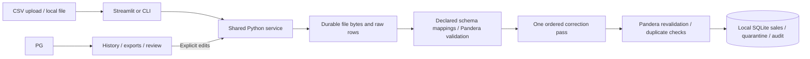

# Self-Correcting Data Pipeline

A local sales CSV application using Python 3.11+, Pandera, SQLite, SQLAlchemy,
Streamlit, and pytest. No database server, credentials, or PostgreSQL connection
is needed. Every completed batch gives each input row one final outcome.

## Run locally (PowerShell)

```powershell
python -m venv .venv
.\.venv\Scripts\python -m pip install -e ".[test]"
.\.venv\Scripts\python -m streamlit run streamlit_app.py
```

Open <http://localhost:8501>. Select **Upload**, choose `us_sales`, upload
`samples/messy.csv`, inspect the preview, and click **Process and persist**.
History, accepted records, correction audits, and quarantine reviews save
locally and survive app restarts.

Storage initializes automatically at `data/pipeline.sqlite3`. To change its
location, set `PIPELINE_DB_PATH` in your environment or `.env`; relative paths
resolve from the project directory. Copying `.env.example` is optional. Legacy
`DATABASE_URL` and `TEST_DATABASE_URL` settings are ignored. Existing PostgreSQL
data is left untouched; this edition starts a separate local store.

Back up the SQLite file while the app and CLI are stopped. Keep it on a local
disk rather than opening the same database from several machines or syncing it
while writers are active. This project's default directory is inside OneDrive;
you can set `PIPELINE_DB_PATH` to a folder outside OneDrive.

```powershell
.\.venv\Scripts\python -m pipeline.cli ingest samples/messy.csv --profile us_sales
.\.venv\Scripts\python -m pipeline.cli summary 1
.\.venv\Scripts\python -m pipeline.cli retry 1
```

On macOS/Linux, use `.venv/bin/python` instead.

## Live correction screen

The default screen matches the report's demonstration: choose **Safe corrections**
or **Unsafe values**, run one correction pass, and inspect actual stage counters,
before/after values, audit entries, and validation reasons. Safe corrections
finish in **one pass with two validation calls**. Unsafe values retain reasons
for quarantine. Reset starts a fresh demonstration; individual field edits are
not separate iterations. Demonstrations do not save sales. Use **Upload** for
persistent processing and duplicate checks.

The **Automated tests** option shows timestamped captured output. Generate it
with `.\.venv\Scripts\python scripts/run_healing_report_tests.py`.

## Tests

```powershell
.\.venv\Scripts\python -m pytest -q
```

The full suite runs without external services. Persistence tests create isolated
SQLite files in pytest temporary folders and never clear application data.
Coverage includes corrections, ambiguous inputs, exact money beyond float
precision, duplicate conflicts, replay and concurrency, manual review,
rollback/retry, UI navigation, and the full 240-row demonstration.

## Optional Docker

```powershell
docker compose up --build -d
docker compose exec app pipeline ingest samples/messy.csv --profile us_sales
docker compose exec app python -m pytest -q
docker compose down
```

Compose runs only the application on localhost:8501. The `pipeline_data` volume
preserves its SQLite file. There is no database service or port 5432.

## Architecture and flow



The smallest end-to-end path is the same one used by the full demo: upload,
persist the original bytes, map columns, validate, correct safe issues,
revalidate, decide duplicate disposition, and commit outputs atomically.
`pipeline/quality.py` is independent of the UI/database. `pipeline/service.py`
owns transactions and business decisions. `pipeline/db.py` defines tables and
an ordered transactional migration runner. `schema_versions` tracks migration
1; add numbered migrations there for future schema changes rather than editing
an existing deployed migration. `BEGIN IMMEDIATE` serializes migrations.

## Contract and explicit policies

Required columns: `transaction_id`, `customer_id`, `transaction_date`, `product`,
`quantity`, `unit_price`, `currency`, `country`, `total_amount`. `email` is
optional, but validated when supplied. IDs/product are nonempty text of at most
200 characters; product is free text, not an invented catalog. Quantity must be
a positive 32-bit integer. Dates must be real calendar dates. Email uses a
documented modest syntax check (one `@`, no whitespace, dotted domain, maximum
254 characters), not deliverability verification or full RFC support.

Money is `Decimal` in Python and integer cents in SQLite (converted back to `Decimal` when read). Supplied prices
and totals must have at most two fractional digits and 16 integer digits.
Exponents and implicit precision loss are rejected. The equation is
`total_amount = (quantity * unit_price).quantize(Decimal('0.01'), ROUND_HALF_UP)`.
Database constraints also enforce positivity, supported country/currency,
business key uniqueness, and the total equation. No binary float math is used.
Outliers are never replaced merely for being unusual.

Supported currencies: **USD, EUR, GBP, INR**. Canonical countries: **United
States, United Kingdom, Germany, France, India**. These are demo values, not
exhaustive global coverage. Unknown currencies/countries are quarantined.

Explicit country aliases: `US`, `USA` → United States; `UK` → United Kingdom;
`DE` → Germany; `FR` → France; `IN` → India. Currency aliases: `usd`, `eur`,
`gbp`, `inr` → uppercase equivalents; `US Dollar` → USD; `Euro` → EUR.
Matching is case sensitive after surrounding whitespace is trimmed.
Recognized leading symbols `$`, `€`, `£`, `₹` are removed only if they match
the row's declared USD, EUR, GBP, INR currency respectively. `$` means USD in
this limited demo, not every global dollar currency. Conversion between
currencies is not supported.

Source profiles are packaged in `pipeline/profiles.json`:

| Profile | Date formats | Decimal | Thousands | Recalculate totals |
| --- | --- | --- | --- | --- |
| `us_sales` | `%Y-%m-%d`, `%m/%d/%Y` | `.` | `,` | Yes |
| `eu_sales` | `%Y-%m-%d`, `%d/%m/%Y` | `,` | `.` | No |
| `iso_strict` | `%Y-%m-%d` | `.` | none | No |

Numeric parsing requires well-formed grouping (groups of three), with no
separator guessing, exponent notation, or parentheses. A source profile is the
explicit declaration of locale; `01/02/2026` means January 2 under `us_sales`
and February 1 under `eu_sales`. An undeclared `01/02/03` is rejected. If custom
declared date formats yield multiple different dates, correction is refused.
Decimal quantities such as `2.0` become integers only when exact. Totals are
recalculated only for an authoritative source, with valid quantity/unit_price
**and an existing valid supplied total**. Missing or unparseable totals are
quarantined. Missing required business values are never invented. Email values
are only whitespace-trimmed, never rewritten to manufacture a valid address.

Example corrected row: `country=USA, quantity=2.0, unit_price=$10.25,
currency=USD, total_amount=20.00` under `us_sales` becomes `United States, 2,
10.25, USD, 20.50`. Every changed field gets a rule ID/version, before/after,
reason, applied flag, timestamp, and whole-record revalidation result.
Example quarantined row: `transaction_date=01/02/03, unit_price=€10.25,
currency=USD` retains both actionable reasons; a successful trim elsewhere
does not turn it into an accepted row.

CSV policy: UTF-8 (optional BOM), comma delimited, header required, at most
5 MiB and 10,000 rows, maximum 10,000 characters per cell. Exact bytes are
stored before schema mapping. Raw rows preserve strings, unknown columns, and
physical starting line numbers, including multiline CSV records. Header
whitespace is trimmed; configured `cust_id` → `customer_id` and `txn_id` →
`transaction_id` aliases are explicit. Conflicting aliases/duplicate headers
fail the batch, as do missing required columns, malformed row widths, NUL
bytes, decoding errors, and malformed quoting. Unknown columns are retained
in raw input only and displayed in the preview. Mapping provenance is stored
on the batch, without uncertain automatic inference.

Changed canonical header mappings also create a `column_mapping` correction
audit event for each affected source row, with the original and canonical
header names. Such rows count as corrected even if their field values were
already valid. Audit field names beginning `column:` distinguish header
corrections from changes to business values.

The byte limit is checked before persistence to bound resource use. Within
that limit, malformed files are retained as failed input batches; the preview
reports the issue and processing can still persist the failure. No records are
fabricated for an unparseable file. Spreadsheet exports prefix risky cells
with an apostrophe (including leading whitespace/control characters) while
leaving stored values unchanged. Export JSON cells remain JSON strings.

## Idempotency, duplicates, and metrics

Submission identity is SHA-256 of exact file bytes plus profile name and a
fingerprint of the profile, supported values/aliases, limits, and ruleset
version. A unique submission constraint and atomic insert reuse the same batch
even for concurrent equivalent submissions. Reprocessing a completed batch
does no work and appends no audit events. Different filenames do not affect
identity. New bytes, profile, or configuration create a new batch.

Duplicate checks use canonical normalized content, including email, with money
formatted to two decimal places and quantities canonicalized. Within a batch,
**every row** sharing a key with different normalized content is quarantined,
including otherwise valid rows and invalid siblings. No input-order winner is
chosen. Exact valid duplicates collapse to the first source row; each excluded
row has a duplicate decision pointing to its representative. Exact invalid
duplicates each stay in quarantine so their validation issues remain visible.
An incoming row identical to an existing accepted sale is excluded, while an
incoming conflicting version is quarantined and the accepted sale is preserved.

SQLite `BEGIN IMMEDIATE` transactions serialize acceptance decisions across
threads and separate processes, including manual review; foreign keys and
database uniqueness provide final safeguards. Transactions wait up to 30 seconds
for another writer. This deliberately trades throughput for simple deterministic
local MVP behavior.

Validity (`valid`, `corrected`, `invalid`) is separate from disposition
(`accepted`, `quarantine`, `duplicate`). Final row outcomes are mutually
exclusive: `accepted_valid`, `accepted_corrected`, `quarantined`, or
`excluded_duplicate`. Their sum equals input rows on a completed batch. Rates
use **all input rows** as denominator. Pending/failed batches also report
unprocessed rows. Corrections to quarantined or excluded rows are never counted
as accepted. Correction audit revalidation is before business-key duplicate
checks; it is not an acceptance flag. Durations measure the most recent batch
processing attempt; reviews do not rewrite processing duration.

## Failures, safe retries, and manual review

Batch states are `pending`, `processing`, `completed`, `failed`. Submission bytes
and parsed raw rows commit separately before the atomic output transaction.
An unexpected processing failure rolls back all sales, audit, quarantine, and
duplicate decisions from that attempt; the batch is then marked `failed` with
`error_kind=operational`. Schema/CSV failures use `error_kind=input`. Per-row
data quality problems yield a completed batch with quarantined rows.

```powershell
docker compose exec app pipeline retry 1
```

The UI exposes the same retry. Process interruption may leave a `pending` or
`processing` batch; explicit retry is safe. If the local storage file is unavailable or unwritable,
the application cannot write a failure marker until file access is restored; retry
the existing batch, or resubmit identical bytes if the initial insert never
committed. Logs expose the exception; the UI does not print connection secrets.
There are no durable partial accepted outputs from a failed transaction.

In **Quarantine review**, select a row, inspect original input and reasons,
enter a reviewer name, edit canonical fields, and resubmit. The exact submitted
edits, prior current values, normalized result, issues, outcome, actor, and time
are retained in `manual_reviews`. Reviews run the same one-pass correction,
validation, and existing-sale duplicate checks. A human may explicitly resolve
an in-batch conflict by submitting the verified version; other conflicting rows
remain quarantined. A reviewed accepted row counts as corrected even if no
automated field repair was needed. Prior quarantine snapshots receive a
resolution time, and unsuccessful reviews create a fresh unresolved snapshot.
Original bytes and raw row values never change. Replaying the file returns the
same batch, including its review history. Reviews update current dashboard
outcomes; historical outcomes remain in quarantine/review/duplicate tables.

## Reproducible demo

```powershell
.\.venv\Scripts\python scripts/generate_samples.py
```

The generator uses no random state, external sources, or current clock.
`samples/clean.csv` has 5 rows; `samples/messy.csv` has 240; `samples/eu.csv`
demonstrates declared European formats. For an empty accepted store, messy
produces **20 accepted valid, 60 accepted corrected, 140 quarantined, 20 excluded
duplicates**. Exact expected counts and preconditions are committed in
`samples/expected.json` and asserted in a local SQLite end-to-end test.
The messy demo covers whitespace/aliases, date/numeric formatting, total
mismatches, exact/conflicting duplicates, missing values, unsupported dates,
invalid quantities/prices/emails, symbol conflicts, and unknown countries.
Running the same file/profile twice returns the same batch and counts.

## Extend and understand limitations

To add a rule, define its stable ID, version, fields, applicability predicate,
and structured `Result` transform in `pipeline/quality.py`; insert it in the
explicit rule order. Keep it deterministic, avoid missing-value inference,
and test both safe and unsafe conditions. Increment `RULESET_VERSION` in
`pipeline/config.py` whenever rule behavior changes. Each field/rule is visited
once, followed by one conditional total rule; no looping or rule promotion is
possible. Failed attempts are audited and force quarantine.

Add profiles in `pipeline/profiles.json`, specifying date formats, numeric
separators, column aliases, authority policy, and a new profile version. Add
tests demonstrating ambiguous values and source-specific parsing. Profile
changes alter submission identity automatically. Retrying or reviewing old
batches under changed global rules/configuration is refused; submit a new batch
under the current version. Preserve the old application version to reproduce
old corrections. Do not silently edit deployed database migration 1.

This local MVP has no authentication, encryption at rest, automated retention,
streaming, external catalog, exchange rates, orchestration platform, or AI
corrections. Reviewer names are audit labels, not verified identities. Sales
contain potentially sensitive customer/email data; use demo input locally.
The application stores entire bounded files and validates rows individually,
so it is intended for demonstration volumes. Production access controls,
retention, backup, incremental migrations, throughput work, and deployment are
future extensions.
